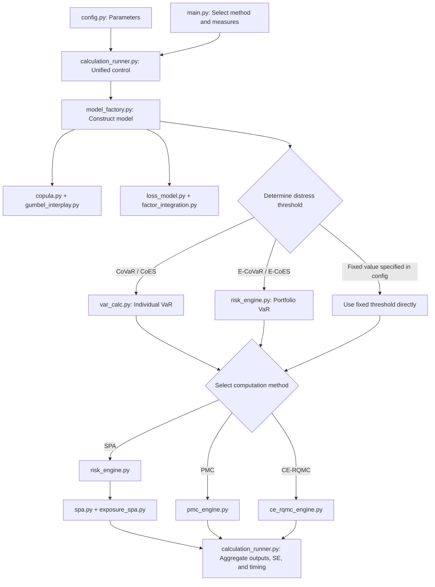

# CoVaR Main Computation Program

## 0. Quick Start

1. Select the method and measures in `main.py`. The current default computes CoVaR and CoES using SPA:

   ```python
   # "spa", "pmc", "ce_rqmc"
   # "covar", "coes", "ecovar", "ecoes"
   return run_calculation("spa", "coes", cfg)
   ```

2. Set the model and distress parameters in `config.py`, or keep the defaults for a first run:

   ```python
   COPULA_TYPE = 't' # 'Gaussian', 't', or 'Skew-t'
   XI = 1.0 # Dependence parameter for Gumbel copula
   CONDITION_MODE = "equality" # or "inequality"
   target_i = 200  # The 201st obligor (zero-based indexing)
   alpha = 0.99  # or 0.999
   beta = 0.99  # or 0.999
   ```

   The default portfolio contains 500 obligors. See Sections 2 and 3 below for other methods, measures, and parameters.

3. Run the program from the same folder:

   ```bash
   python main.py
   ```

   The terminal displays the selected model and conditioning setting, risk estimates, and CPU / wall time. PMC and CE-RQMC also report simulation standard errors. There is no need to modify the intermediate computation modules.

## 1. Files

```text
config.py                         Parameters and runtime controls
    ↓
model_factory.py                  Construct portfolio, Copula, factor integration, and SPA parameters
    ↓
Computation core
    ├─ risk_engine.py             Four types of risk measures via SPA
    │    ├─ spa.py                SPA for CDF, density, and stop-loss
    │    └─ exposure_spa.py       Marked-law SPA for L | L_i <= y
    ├─ pmc_engine.py              Plain Monte Carlo
    └─ ce_rqmc_engine.py          Iterative CE and randomized QMC
    ↓
calculation_runner.py             Shared execution workflow, distress thresholds, timing, repeated runs, SE, and result output
    ↓
main.py                           Entry for the main computation; selects the method and measures
```

Supporting modules:

- `copula.py`, `gumbel_interplay.py`: Copula, Gumbel dependence, and conditional default probabilities.
- `factor_integration.py`: Gauss–Legendre/Rosenblatt integration nodes and weights in probability space.
- `loss_model.py`: Beta LGD model and the first four derivatives of the MGF.
- `var_calc.py`: Analytical calculation of individual VaR; portfolio VaR is calculated by the SPA risk engine.

For a given risk measure, all three methods share the portfolio parameters, confidence levels, conditioning direction, and distress-threshold conventions.
`main.py` only specifies the method and measures.

The following diagram shows the computation workflow:



Note: Automatic exposure distress thresholds currently use the same SPA portfolio VaR across all methods;
final conditional risk estimation for PMC and CE-RQMC is performed by their respective simulation engines.

## 2. Select the method and measure in `main.py`

Modify the following line in the single entry point, `main.py`:

```python
return run_calculation("spa", "coes", cfg)
```

The first string selects the method:

| String | Method |
|---|---|
| `"spa"` | SPA |
| `"pmc"` | Plain Monte Carlo |
| `"ce_rqmc"` | CE-RQMC |

The second string selects the measure:

| String | Output |
|---|---|
| `"covar"` | CoVaR |
| `"coes"` | CoVaR + CoES |
| `"ecovar"` | E-CoVaR |
| `"ecoes"` | E-CoVaR + E-CoES |

For example, `run_calculation("spa", "ecoes", cfg)` calculates E-CoVaR and E-CoES using spa.
All options are also explained individually in the comments in main.py.
ES automatically calculates the corresponding quantile first; PMC and CE-RQMC report a standard error (SE) for each output measure.

## 3. Select parameters in `config.py`

### Portfolio and model

- `N`, `u`, `a`, `b`, `p`, `rho`: Portfolio size, exposures, Beta LGD shape parameters, PD, and factor loadings.
  All arrays must have length N.
- `COPULA_TYPE`: `'Gaussian'`, `'t'`, or `'Skew-t'`.
- `nu`: Degrees of freedom for t / skew-t; `gamma`: Skewness for skew-t.
- `XI`: Gumbel dependence parameter for t / skew-t; 1 indicates independent scale factors.
- `rho` is a loading; for example, `sqrt(0.50)` corresponds to a latent-variable asset correlation of 0.50.

### Distress conditions

```python
CONDITION_MODE = "equality"   # or "inequality"

target_i = 200               # Zero-based index; 200 is the 201st institution
alpha = 0.99                 # Confidence level for the distress threshold
beta = 0.99                  # Confidence level for the conditional quantile / ES

```
