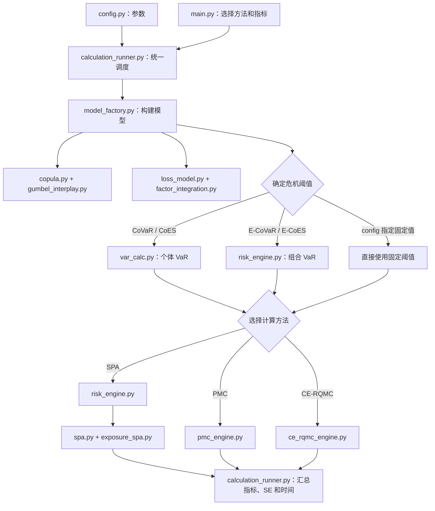

# CoVaR 主计算程序

日常操作：**在 `main.py` 选择方法和指标 → 在 `config.py` 修改参数 → 运行 `main.py`。**
不需要修改中间的计算模块，也不需要添加命令行参数。

## 1. 架构与文件分工

```text
config.py                         参数与运行控制
    ↓
model_factory.py                  校验输入，构建组合、Copula、因子积分及 SPA 参数
    ↓
计算核心
    ├─ risk_engine.py             SPA 四类风险指标
    │    ├─ spa.py                CDF、密度、stop-loss SPA
    │    └─ exposure_spa.py        L | L_i <= y 的 marked-law SPA
    ├─ pmc_engine.py              直接 Monte Carlo
    └─ ce_rqmc_engine.py          CE 校准及随机化 QMC
    ↓
calculation_runner.py             共用调用流程、危机阈值、计时、重复计算、SE、结果输出
    ↓
main.py                           唯一主计算入口，选择方法和指标
```

辅助核心模块：

- `copula.py`、`gumbel_interplay.py`：Copula、Gumbel 依赖和条件违约概率。
- `factor_integration.py`：概率空间的 Gauss–Legendre/Rosenblatt 积分节点及权重。
- `loss_model.py`：Beta LGD 损失模型和 MGF 的前四阶导数。
- `var_calc.py`：个体 VaR 的解析计算；组合 VaR 由 SPA risk engine 计算。

同一指标的三个方法共用组合参数、alpha、beta、条件方向和危机阈值约定。
main.py 只指定方法和指标；算法与报告逻辑不在 main 文件中重复实现。

## 2. 在 main.py 中选择方法和指标

修改唯一入口 main.py 中的这一行：

```python
return run_calculation("spa", "coes", cfg)
```

第一个字符串选择方法：

| 字符串 | 方法 |
|---|---|
| `"spa"` | SPA |
| `"pmc"` | Plain Monte Carlo |
| `"ce_rqmc"` | CE-RQMC |

第二个字符串选择指标：

| 字符串 | 输出 |
|---|---|
| `"covar"` | CoVaR |
| `"coes"` | CoVaR + CoES |
| `"ecovar"` | E-CoVaR |
| `"ecoes"` | E-CoVaR + E-CoES |

例如 `run_calculation("ce_rqmc", "ecoes", cfg)` 计算 CE-RQMC 的 E-CoVaR 和 E-CoES。
所有选项也在 main.py 的注释中逐项说明。
ES 会自动先计算对应分位数；PMC 和 CE-RQMC 对各输出指标分别给出 SE。

## 3. 在 config.py 中修改什么

### 组合与模型

- `N`、`u`、`a`、`b`、`p`、`rho`：组合规模、敞口、Beta LGD 形状、PD 和因子载荷。
  所有数组长度必须等于 N。
- `COPULA_TYPE`：`'Gaussian'`、`'t'` 或 `'Skew-t'`。
- `nu`：t / skew-t 自由度；`gamma`：skew-t 偏度。
- `XI`：t / skew-t 的 Gumbel 依赖参数；1 表示独立尺度因子。
- `rho` 是载荷；例如 `sqrt(0.50)` 对应潜在变量资产相关度 0.50。

### 主程序控制与危机条件

```python
CONDITION_MODE = "equality"   # 或 "inequality"
SHOW_PROGRESS = False

target_i = 200               # 从 0 开始，200 是第 201 个机构
alpha = 0.99                 # 危机阈值的置信水平
beta = 0.99                  # 条件分位数 / ES 的置信水平

SYSTEM_DISTRESS_THRESHOLD = None
EXPOSURE_DISTRESS_THRESHOLD = None
```

- CoVaR/CoES：以机构损失 L_i 为条件，计算组合损失 L 的风险。
- E-CoVaR/E-CoES：以组合损失 L 为条件，计算机构损失 L_i 的风险。
- `equality`：条件损失等于阈值；`inequality`：条件损失大于或等于阈值。
- `SYSTEM_DISTRESS_THRESHOLD=None`：自动用个体 VaR(alpha)，解析计算。
- `EXPOSURE_DISTRESS_THRESHOLD=None`：自动用组合 VaR(alpha)，统一用 SPA 计算。
- 若设置为数值，例如 `EXPOSURE_DISTRESS_THRESHOLD=100.0`，直接用固定组合损失 100，
  不再由 alpha 求该阈值。数值必须非负并小于对应损失的最大支持点。

**Benchmark 的 SE 条件于上述固定阈值，不包含阈值自身的误差。**
如果需要完全基于模拟的 exposure 对照，可以把独立模拟得到的组合 VaR 填入
`EXPOSURE_DISTRESS_THRESHOLD`。PMC / CE-RQMC 的条件风险估计本身不调用 SPA。

### SPA 精度和并行

- `SPA_GAUSSIAN_FACTOR_ORDER`：Gaussian 因子积分阶数，默认 512。
- `SPA_T_FACTOR_ORDER`、`SPA_SCALE_ORDER`：t / skew-t 两个因子的积分阶数，默认 64 × 64。
- `SPA_LGD_ORDER`：LGD 积分以及 E-CoES 生存函数积分阶数，默认 32。
- `SPA_QUANTILE_TOL`：分位数求解的绝对容差。
- `SPA_N_JOBS`：因子积分工作进程数；1 表示串行。
- `SPA_MGF_GRID_SIZE`、`SPA_MGF_S_MIN/MAX`：MGF 插值网格。
- `SPA_EXACT_MGF_RADIUS`：当标量鞍点满足 `abs(s)*max(u) < 0.15` 时使用解析 MGF 及导数，避免均值附近 LR 公式放大样条误差；通常保留默认值。
- `SPA_SADDLE_BOUND`、`SPA_ROOT_TOL`、`SPA_MEAN_REGION`、`SPA_TAIL_BOUND_TOL`：
  鞍点搜索和数值精度设置。鞍点范围必须包含在 MGF 网格范围内。

这些设置也用于 benchmark 共用模型的构建；exposure 自动阈值会受 SPA 精度设置影响。

### PMC 预算与带宽

- `PMC_NUM_SIMS`：每次独立重复的路径数。
- `PMC_NUM_RUNS`：独立重复次数，必须至少 2。
- `PMC_BATCH_SIZE`：每批路径数，控制内存占用。
- `PMC_BASE_SEED`：第 r 次重复使用 BASE_SEED + r（r 从 0 开始）。
- `PMC_EQUALITY_BANDWIDTH_RATIO`：CoVaR/CoES 的等式带宽 h = ratio × u_i。
- `PMC_EXPOSURE_EQUALITY_BANDWIDTH_RATIO`：exposure 等式带宽 h = ratio × max(v, 1)。

### CE-RQMC 预算与带宽

- `CE_RQMC_PRELIMINARY_SIZE/REPLICAS`：独立名义 RQMC 的初步条件分位数估计。
- `CE_RQMC_PILOT_SIZE`：每次 CE 校准点数。
- `CE_RQMC_FINAL_SIZE`：每个最终随机化重复的点数。
- `CE_RQMC_REPLICAS`：最终独立随机化次数，必须至少 2。
- 各 `SIZE` 必须是 2 的整数次幂，如 4096、8192、16384。
- `CE_RQMC_EQUALITY_BANDWIDTH_RATIO`：system 最终带宽 h = ratio × u_i。
- `CE_RQMC_EXPOSURE_EQUALITY_BANDWIDTH_RATIO`：exposure 最终带宽 h = ratio × max(v, 1)。
- `CE_RQMC_CALIBRATION_BANDWIDTH_MULTIPLIER`：初步估计和校准所用的带宽倍数。
- 其余 `CE_RQMC_*` 控制精英比例、初始化、迭代、ESS 回退、defensive mixture 及种子。
  初步、校准和最终阶段的种子范围必须互不重叠。

正损失等式条件使用核带宽近似；零阈值使用精确的零损失原子，不用核带宽。
不等式条件不用核带宽。CE 仅在校准阶段允许扩大带宽，最终估计始终使用配置的最终带宽。
CE 的 SE 条件于一次训练得到的 proposal，来自最终独立随机化重复。

## 4. 如何运行

在项目目录打开终端：

```bash
cd /Users/jaydenwang/Desktop/CoVaR_codex
```

例如，main.py 中选择 `"spa", "coes"`，config 中设 `CONDITION_MODE="equality"`，然后运行：

```bash
python CoVaR_codes/main.py
```

改成 `CONDITION_MODE="inequality"` 后，重新运行相同文件即可计算不等式条件。
在 IDE 中也可以直接运行 main.py；修改 config 后需要重新启动运行，避免旧的模块缓存。
默认大规模模拟可能耗时较长；调试时可先在 config 中减少模拟预算。

## 5. 输出与返回值

默认只显示方法/条件标题、指标值、benchmark 的 SE 和 CPU / wall 时间。
不打印模型参数、危机阈值、ESS、带宽、CE 校准参数或诊断信息。默认关闭进度条；
如需观察进度，可显式设置 `SHOW_PROGRESS=True`。数值异常和精度不足的警告仍会保留。

- SPA：显示 CoVaR（或 E-CoVaR）的计算时间，以及已知该分位数后计算 ES 的增量时间。
- PMC：显示两个指标共用模拟样本的合计时间，包含全部独立重复，不是单次重复的平均时间。
- CE-RQMC：另列初步估计与校准时间；最终估计时间包含全部独立随机化重复。
- 准备时间：模型构建及危机阈值计算。
- 总计：包含准备、计算、CE 初估/校准（如适用）和清理。
- CPU 是累计处理器时间（含 SPA 工作进程）；wall 是实际等待时间。单位均为秒。
- 计时不包括 Python 启动和模块导入时间。

SE 仍使用 `独立重复估计值的样本标准差 / sqrt(重复次数)`，样本标准差采用 `ddof=1`。
返回对象中的完整参数、诊断、各阶段计时和逐次估计值仍然保留，仅精简屏幕输出。

需要在自己的 Python 程序中取得返回值时（脚本放在本目录）：

```python
from calculation_runner import run_calculation

if __name__ == "__main__":
    result = run_calculation("pmc", "ecoes")
    print(result.values["E-CoVaR"])
    print(result.values["E-CoES"])
    print(result.standard_errors["E-CoES"])
    print(result.timings["total"].wall_seconds)
    print(result.replication_values)  # 列顺序与 result.values 的键顺序相同
```

也可以 `import main` 后调用 `main.main()`，返回相同的结果对象。
`run_calculation(..., report=False)` 关闭文本报告；进度条由 config 的 SHOW_PROGRESS 控制。

## 6. 保留文件与架构（2026-09-12 清理后）

main.py 的完整本地依赖闭包共 **14 个 Python 文件**：

| 文件 | 作用 |
|---|---|
| `main.py` | 唯一主计算入口，选择方法与指标 |
| `config.py` | 模型、危机条件、精度和模拟预算 |
| `calculation_runner.py` | 统一调度、阈值、重复模拟、SE、计时及输出 |
| `model_factory.py` | 校验配置、构建模型及计算对象 |
| `copula.py` | Gaussian/t/skew-t Copula 和条件违约概率 |
| `gumbel_interplay.py` | Gumbel 依赖结构与条件反演 |
| `factor_integration.py` | 因子积分节点与权重 |
| `loss_model.py` | 组合与 Beta LGD 的 MGF、导数 |
| `var_calc.py` | 个体 VaR 解析计算；保留边际概率校验辅助函数 |
| `risk_engine.py` | SPA 的 CoVaR、CoES、E-CoVaR、E-CoES 及组合 VaR |
| `spa.py` | SPA 的 CDF、密度及 stop-loss 基础公式 |
| `exposure_spa.py` | E-CoVaR 所需的 marked-law SPA |
| `pmc_engine.py` | PMC 模拟和条件风险估计 |
| `ce_rqmc_engine.py` | CE 校准及随机化 QMC 估计 |

另保留 `convergence_check.py` 和 `tests/` 下五个测试文件。
前者是数值精度检查工具，目前只覆盖 CoVaR/CoES；后者是核心回归验证，
均不属于已经废弃的 Section 5 批量实验。

以下是调用与计算流程图（不是每一个 Python import 的逐项展示）：



说明：所有方法的 exposure 自动危机阈值当前共用 SPA 组合 VaR；
PMC 与 CE-RQMC 的最终条件风险估计由各自的模拟引擎完成。

本次从 CoVaR_codes 移除 27 个过时文件：

- 3 个 `run_spa_*_study.py` 与 3 个 `plot_spa_*_results.py`。
- 6 个旧实验结果 CSV 与 6 个 PNG/PDF 图表。
- 6 个旧兼容模块：`main_coes.py`、`main_ineq.py`、`main_ineq_coes.py`、
  `spa_equality_compat.py`、`mc_verify.py`、`benchmark_main.py`。
- 历史市场数据探索 `test.py` 及它使用的 `SP500.csv`、`VIXCLS.csv`。

`mc_verify.py` 已无主体调用方：其旧接口功能由 calculation_runner.py 与
pmc_engine.py 承担；`var_calc.py` 则被主体直接调用，必须保留。
旧模块专用的 3 个兼容性测试用例随旧模块移除，核心数学与运行测试保留。

移除前已备份并校验到代码目录之外：
`../output/archive/section5_cleanup_20260912.zip`。
该备份包含删除文件、原说明/测试文件及 SHA-256 清单，可以恢复。
论文目录中仍被 LaTeX 引用的图片保持原状，避免影响现有稿件编译。

## 7. 数学约定与验证

- 正损失等式条件使用 regular conditional density；其事件概率是零。
- `L_i=0` 是机构不违约原子；`L_i>=0` 给出无条件组合风险。
- `L=0` 时机构损失也为零；`L>=0` 给出无条件机构风险。
- ES 使用 `q + E[(loss-q)^+ | condition]/(1-beta)`，正确保留分位数原子的修正。
- E-CoVaR 的 SPA 使用 marked-law CGF、二阶 Daniels 密度（等式）及 LR CDF（不等式）。
- E-CoES 积分条件生存函数；分位数先检查零损失原子。
- 鞍点超出插值范围时，密度只能在专门的指数密度上界足够小时截断为零，
  不以概率尾界替代密度界。该上界要求 Beta 形状参数均至少为 1；
  不满足且鞍点无法括住时会报错，应扩大数值范围。
- 非有限值或明显无效的 SPA 结果会报错，不会当作成功结果输出。

运行测试：

```bash
python -m pytest -q CoVaR_codes/tests
```

数值稳定性修复后 **78 项自动测试全部通过**。自动测试覆盖原有公式、exposure 公式与 PMC 数值对照、全部方法/指标组合在两种条件下的参数传递，以及统一 main 入口、
各指标 SE、计时、零阈值、t/skew-t Gumbel 依赖模型，以及统一入口的实际执行。
原配置下的生产规模 SPA 运行另作实算核验；benchmark 的入口验证使用缩小的模拟预算，
不等同于完整的论文精度实验。

正式出表前仍应检查因子/LGD 积分加密以及模拟预算、等式带宽敏感性。
例如 Gaussian 可以把 `SPA_GAUSSIAN_FACTOR_ORDER` 从 512 加到 1024，
把 `SPA_LGD_ORDER` 从 32 加到 64，重复运行 main.py；t/skew-t 同时加密两个因子阶数。

### 当前默认参数的 SPA 实算核验

2026-09-11，Gaussian、N=1000、target_i=200、alpha=beta=0.99，保持原有组合参数：

| 条件 | CoVaR | CoES | E-CoVaR | E-CoES |
|---|---:|---:|---:|---:|
| equality | 223.9860033769 | 241.5260667729 | 0.6038131714 | 0.6745341507 |
| inequality | 224.0684120595 | 241.7305046861 | 0.6366271973 | 0.7009666079 |

个体阈值为 0.2307478848，组合阈值为 102.1921028928。
Exposure 数值与整理前一致；全部四组运行均输出了分阶段及总 wall/CPU 时间。
本表为此前主程序整理时的核验记录；旧 Section 5 脚本与代码目录内的结果文件已于 2026-09-12 清理，见第 6 节。

### 保持数值行为的计算开销优化

SPA 复用固定 MGF 导数系数与同一鞍点的中间量；PMC 减少临时数组并仅排序有条件权重的路径；CE-RQMC 仅对违约机构求 LGD 逆分布，保留原有 Sobol 点与随机维度。
公式、积分阶数、求根容差、预算和用户配置均未修改。
测试增加缓存失效及完整/稀疏 LGD 路径一致性验证。
完整时间口径、前后对照和保留的已有数值限制见 `../output/spa_optimization_validation.md`。

2026-09-13 的 E-CoVaR/E-CoES 差异诊断与修复证据见 [验证报告](../output/exposure_discrepancy_validation.md)。
